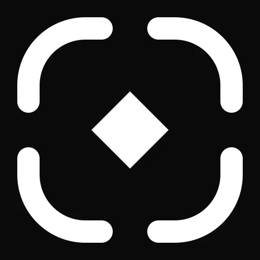

  

  <h1>Omorphia</h1>
  
<strong>A framework-free UI component library for the browser.</strong>

  
Native custom elements. Plain CSS. CDN-first delivery.

  

    
    
    
  

  
<a href="https://aabhro.github.io/Omorphia/"><strong>Open the live demo ↗</strong></a>

  

    <a href="https://aabhro.github.io/Omorphia/">Live demo</a>
    &nbsp;·&nbsp;
    <a href="#overview"> Overview</a>
    &nbsp;·&nbsp;
    <a href="#install-from-the-cdn"> Installation</a>
    &nbsp;·&nbsp;
    <a href="#components"> Components</a>
    &nbsp;·&nbsp;
    <a href="#theming"> Theming</a>
    &nbsp;·&nbsp;
    <a href="#repository-map"> Repository</a>
  

---

<h2 align="center" id="overview">&nbsp; Overview</h2>

Omorphia is a small UI system for websites and web applications. It combines native custom elements, browser APIs, and plain CSS without requiring a framework or runtime package manager.

Load the stylesheet and script, then use the components directly in your markup. The elements register when the script loads, including elements added later.

| Foundation | What it provides |
|:--|:--|
| **Custom elements** | Buttons, forms, navigation, overlays, search, sidebars, and more |
| **Browser-native behavior** | Semantic controls, keyboard interaction, and accessible states |
| **Design tokens** | Shared CSS variables with global and scoped theme overrides |
| **Built-in icons** | A bundled Lucide icon set |
| **Modular CSS** | A complete stylesheet or focused modules |
| **Directional illumination** | A subtle top-left highlight and dimmer bottom-right reflection on selected edges |

[**Open the live demo**](https://aabhro.github.io/Omorphia/) · [Showcase source](index.html) · [Source styles](src/css/) · [Component logic](src/js/)

<h2 align="center" id="install-from-the-cdn">&nbsp; Install from the CDN</h2>

Omorphia is published through jsDelivr. The browser loads the library directly from this repository. No copied library files or build step are required in the consuming project.

### Classic script

  
<strong>HTML installation</strong>

Use the classic bundle when you want the global <code>Omorphia</code> API.

~~~html
<link
  rel="stylesheet"
  href="https://cdn.jsdelivr.net/gh/aabhro/Omorphia@v1.1.7/dist/omorphia.min.css"
>

<ui-button variant="primary" icon="save">Save changes</ui-button>
<ui-command-palette></ui-command-palette>

~~~

### ES module

  
<strong>Import the complete API</strong>

Load the stylesheet separately, then import the module in the browser.

~~~html
<link
  rel="stylesheet"
  href="https://cdn.jsdelivr.net/gh/aabhro/Omorphia@v1.1.7/dist/omorphia.min.css"
>

~~~

### Individual CSS modules

  
<strong>Load only the styles you need</strong>

Load <code>core.min.css</code> first. It contains the design tokens, base styles, and edge effect. Add the modules required by your interface.

~~~html
<link rel="stylesheet" href="https://cdn.jsdelivr.net/gh/aabhro/Omorphia@v1.1.7/dist/css/core.min.css">
<link rel="stylesheet" href="https://cdn.jsdelivr.net/gh/aabhro/Omorphia@v1.1.7/dist/css/button.min.css">
<link rel="stylesheet" href="https://cdn.jsdelivr.net/gh/aabhro/Omorphia@v1.1.7/dist/css/forms.min.css">
<link rel="stylesheet" href="https://cdn.jsdelivr.net/gh/aabhro/Omorphia@v1.1.7/dist/css/feedback.min.css">
~~~

Available modules: <code>button</code>, <code>forms</code>, <code>nav</code>, <code>feedback</code>, <code>containers</code>, and <code>advanced</code>.

The complete stylesheet is <a href="dist/omorphia.min.css"><code>dist/omorphia.min.css</code></a>. Integrity hashes for the published bundles are in <a href="dist/sri.json"><code>dist/sri.json</code></a>.

### Versioning and network requirements

- **Development:** use the <code>@main</code> URLs to follow the current default branch.
- **Production:** pin an exact release tag, such as <code>@v1.1.7</code>, so deployed projects use a known revision.
- **Online requirement:** the browser must be able to reach <code>cdn.jsdelivr.net</code>. CDN imports do not work offline unless the project deliberately hosts the files locally.
- **Content Security Policy:** allow <code>https://cdn.jsdelivr.net</code> in the relevant <code>style-src</code> and <code>script-src</code> directives.
- **ES modules:** load the module in the browser runtime. Keep browser-only imports out of server-side rendering entry points.

<h2 align="center" id="components"> Components</h2>

The stylesheet is split into focused modules. The JavaScript bundle registers the corresponding custom elements and exposes the public API.

| Module | Includes |
|:--|:--|
| <code>core</code> | Design tokens, base styles, and directional illumination |
| <code>button</code> | Buttons and button groups |
| <code>forms</code> | Inputs, textareas, selects, checkboxes, radios, switches, and ranges |
| <code>nav</code> | Breadcrumbs, navigation links, tabs, and pagination |
| <code>feedback</code> | Tooltips, alerts, badges, status, progress, and toasts |
| <code>containers</code> | Cards, avatars, dialogs, popovers, dropdowns, and collapsibles |
| <code>advanced</code> | Command palette, search panels, and side navigation |

### Buttons

  
<strong>Markup and variants</strong>

~~~html
<ui-button variant="primary" icon="save">Save</ui-button>
<ui-button variant="secondary">Cancel</ui-button>
<ui-button variant="subtle" icon="ellipsis" label="More options"></ui-button>
~~~

Variants: <code>primary</code>, <code>secondary</code>, <code>subtle</code>, and <code>destructive</code>. Sizes: <code>sm</code>, <code>md</code>, and <code>lg</code>.

### Forms

  
<strong>Field example</strong>

~~~html

  <label class="ui-label" for="project-name">Project name</label>
  

    <ui-icon name="folder"></ui-icon>
    <input id="project-name" placeholder="Untitled project">
  

  
Choose a name for this workspace.

~~~

Use <code>.ui-textarea</code> for textareas. Selects, checkboxes, radios, switches, and range inputs are also included.

### Navigation

  
<strong>Tabs, pagination, and dropdowns</strong>

~~~html
<ui-tabs value="overview">
  <ui-tab label="Overview" value="overview">Overview panel</ui-tab>
  <ui-tab label="Activity" value="activity">Activity panel</ui-tab>
</ui-tabs>

<ui-pagination total="24" page="1"></ui-pagination>

<ui-dropdown>
  <button slot="trigger">Actions</button>
  <button data-value="rename">Rename</button>
  <button data-value="duplicate">Duplicate</button>
</ui-dropdown>
~~~

Tabs support arrow keys, Home, and End. Dropdowns support arrow keys, Home, End, and type-ahead.

### Feedback and dialogs

  
<strong>Toast and confirmation</strong>

~~~js
Omorphia.toast({
  title: 'Changes saved',
  description: 'Your work is up to date.',
  variant: 'success'
});

const confirmed = await Omorphia.confirm({
  title: 'Delete project?',
  message: 'This action cannot be undone.',
  confirmLabel: 'Delete',
  destructive: true
});
~~~

Also available: <code>&lt;ui-tooltip&gt;</code>, <code>&lt;ui-modal&gt;</code>, <code>&lt;ui-popover&gt;</code>, and <code>&lt;ui-dropdown&gt;</code>.

### Command palette

The default shortcut is <kbd>Ctrl</kbd> + <kbd>Shift</kbd> + <kbd>K</kbd> on Windows and Linux, or <kbd>⌘</kbd> + <kbd>Shift</kbd> + <kbd>K</kbd> on macOS. The palette can open while a form field has focus.

Use the arrow keys to move through results, Enter to run a command, and Escape to close.

  
<strong>Register commands</strong>

~~~js
Omorphia.commands.register([
  {
    id: 'new-project',
    label: 'New project',
    group: 'Actions',
    icon: 'plus',
    shortcut: 'N',
    onSelect: () => createProject()
  },
  {
    id: 'docs',
    label: 'Open documentation',
    group: 'Links',
    icon: 'book-open',
    href: '/docs'
  }
]);
~~~

Commands can be registered globally or on an individual palette. Declarative <code>&lt;ui-command&gt;</code> elements are supported too.

### Search and side navigation

  
<strong>Local search data</strong>

~~~js
const search = document.querySelector('ui-search');

search.data = [
  { label: 'Apple', description: 'Fruit', icon: 'apple' },
  { label: 'Mango', description: 'Fruit', icon: 'leaf' }
];

search.addEventListener('ui-select', (event) => {
  console.log(event.detail.item);
});
~~~

Search also supports asynchronous sources, loading states, keyboard selection, and custom item rendering.

  
<strong>Responsive sidebar</strong>

~~~html
<ui-sidebar heading="Workspace" collapsible breakpoint="768">
  <ui-sidebar-item icon="house" href="/" active>Home</ui-sidebar-item>
  <ui-sidebar-item icon="folder">Projects
    <ui-sidebar-item href="/atlas">Atlas</ui-sidebar-item>
    <ui-sidebar-item href="/meridian">Meridian</ui-sidebar-item>
  </ui-sidebar-item>
</ui-sidebar>
~~~

On narrow screens the sidebar becomes an off-canvas drawer. Nested groups, collapse, active states, and keyboard navigation are included.

<h2 align="center" id="illumination"> Directional illumination</h2>

Omorphia keeps its signature edge treatment. A soft highlight begins near the top-left. A dimmer reflection sits near the bottom-right. Both are masked into the border ring, following the component radius.

The effect is available on supported components and can be added to a custom surface with <code>.ui-edge</code>.

  
<strong>Apply illumination to a surface</strong>

~~~html

  An illuminated surface

~~~

| Variable | Default | Purpose |
|:--|:--:|:--|
| <code>--ui-edge-tl-alpha</code> | <code>.5</code> | Top-left strength |
| <code>--ui-edge-br-alpha</code> | <code>.14</code> | Bottom-right strength |
| <code>--ui-edge-tl-reach</code> | <code>52%</code> | Top-left reach |
| <code>--ui-edge-br-reach</code> | <code>42%</code> | Bottom-right reach |
| <code>--ui-edge-base-alpha</code> | <code>.05</code> | Resting edge strength |
| <code>--ui-edge-width</code> | <code>1px</code> | Ring thickness |
| <code>--ui-edge-intensity</code> | <code>1</code> | Overall intensity |
| <code>--ui-edge-hover-boost</code> | <code>1.45</code> | Interactive hover multiplier |

Modifiers: <code>ui-edge--soft</code>, <code>ui-edge--strong</code>, <code>ui-edge--accent</code>, <code>ui-edge--none</code>, and <code>ui-edge--animated</code>. Animated edges respect <code>prefers-reduced-motion</code>.

<h2 align="center" id="theming"> Theming</h2>

Dark is the default. Override the <code>--ui-*</code> variables on <code>:root</code> or scope them to a component or section.

  
<strong>Theme tokens</strong>

~~~css
:root {
  --ui-bg: #0a0a0a;
  --ui-surface: #0a0a0a;
  --ui-overlay: #0a0a0a;
  --ui-text: #f5f5f5;
  --ui-accent: #f5f5f5;
  --ui-radius: 6px;
  --ui-font: "Geist", system-ui, sans-serif;
}
~~~

  
<strong>Switch themes</strong>

~~~js
Omorphia.theme.set('dark');  // dark, light, or auto
Omorphia.theme.toggle();
~~~

Set <code>data-ui-theme="light"</code> on any section for a scoped light theme. Floating panels retain an opaque near-black surface.

<h2 align="center" id="repository-map"> Repository map</h2>

| Path | Purpose |
|:--|:--|
| [index.html](index.html) | Component showcase · [Live demo](https://aabhro.github.io/Omorphia/) |
| [assets/omorphia-mark-preview.webp](assets/omorphia-mark-preview.webp) | Generated white logo preview |
| [src/css/](src/css/) | Source tokens, base styles, modules, and illumination |
| [src/js/](src/js/) | Custom elements, icon system, and public API |
| [dist/](dist/) | CDN-ready CSS and JavaScript bundles |
| [dist/css/](dist/css/) | Individual minified CSS modules |
| [dist/esm/](dist/esm/) | Individual ES module components |
| [showcase/](showcase/) | Showcase-specific styles and behavior |
| [tests/](tests/) | Smoke tests and showcase checks |
| [scripts/](scripts/) | Build and icon generation scripts |
| [assets/](assets/) | Logo and README icons |
| [LICENSE](LICENSE) | MIT license |

<h2 align="center" id="browser-support"> Browser support</h2>

Targets current Chrome, Edge, Safari 16.4+, and Firefox. Omorphia uses custom elements, <code>color-mix()</code>, CSS masks, <code>:has()</code>, and native dialogs. Floating panels use the Popover API where available, with a fixed-position fallback.

<h2 align="center" id="development"> Development</h2>

  
<strong>Build and test locally</strong>

~~~bash
git clone https://github.com/aabhro/Omorphia.git
cd Omorphia
npm install
npm run build
npm test
~~~

The build regenerates the committed CDN bundles and integrity manifest. Source CSS is in <code>src/css/</code>, component logic is in <code>src/js/</code>, and showcase-specific wiring is in <code>showcase/</code>.

<h2 align="center" id="license">License</h2>

MIT. See <a href="LICENSE">LICENSE</a>.

---

   
  <strong>Omorphia</strong> 
  A small, considered foundation for browser interfaces.

